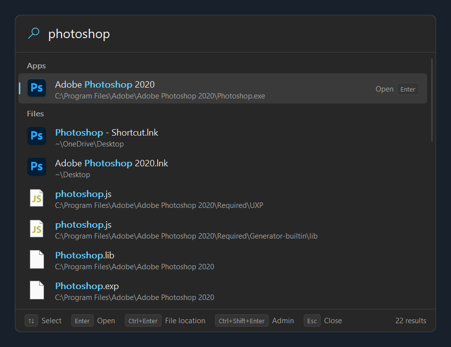
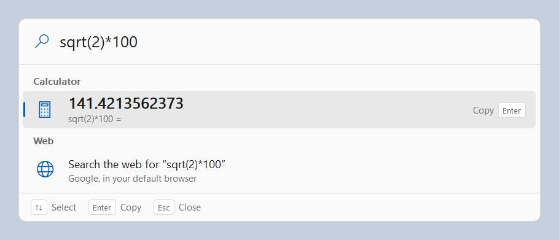
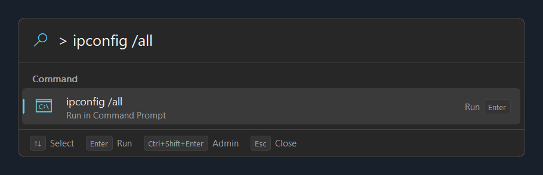
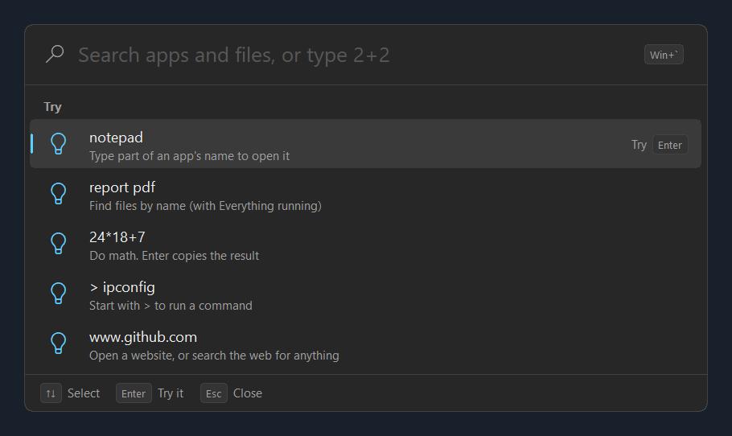
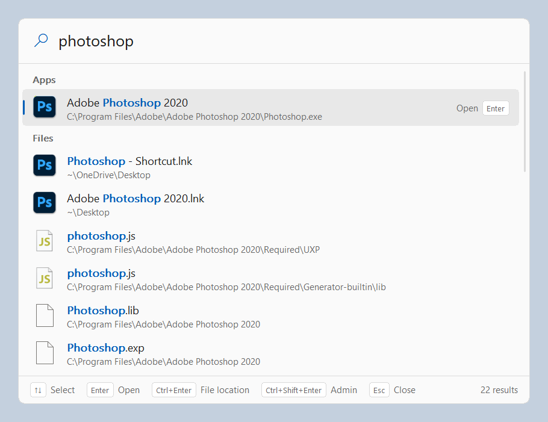

# hop

A tiny keyboard launcher for Windows. Press **`` Win+` ``** (the key above Tab), type, press Enter. One box opens apps,
finds files (through [Voidtools Everything](https://www.voidtools.com/)), does arithmetic, runs
commands and searches the web. It's one native ~380 KB executable with no runtime, no installer, no
plugins and no telemetry.



| | |
| --- | --- |
|  |  |
|  |  |

## Features

- **Apps.** Everything the Start menu lists, both desktop and Store apps, with their real icons.
  Matches are ranked the way you'd expect: the exact name first, then a prefix (`note` → Notepad),
  then a word start (`code` → Visual Studio Code), then an acronym (`vsc`), then a substring, then
  letters in order (`vscode`). Apps you launch often move up.
- **Recent apps.** Open the box without typing and it lists what you launched last. Before you've
  launched anything, it shows examples to try instead.
- **Easy to scan.** Results are grouped under Apps, Files, Calculator and Web. Paths in your profile
  are shortened to `~\...`. Programs and shortcuts show their own icons, and the footer shows what
  each key does for the selected row.
- **Files.** If Everything is running, file results appear below the apps as you type. hop leaves out
  places tools fill up (dot-folders, AppData, node_modules, site-packages, Windows, the Recycle Bin).
  It fetches the 100 newest matches and puts your own files first: Desktop, Documents, Downloads,
  Pictures, OneDrive. Build output and Program Files go last.
- **Calculator.** `24*18+7`, `2^10`, `sqrt(2)/2`, `15% of 80`, `0xff + 1`, `5!`, `3x4`,
  `max(3, 9, 4)`, `pi`, with the usual precedence. Enter copies the result.
- **Commands.** Start with `>` to run something in Command Prompt: `> ipconfig /all`.
- **Web.** The last row searches Google for what you typed, or opens it if it's a URL (`www.example.com`).
- **Native and small.** Win32 and GDI, PerMonitorV2 DPI aware, rounded corners on Windows 11 and
  Windows 10, light and dark themes that follow the system. About 9 MB of private memory while running.
- **Gets out of the way.** It opens centered on the monitor under your mouse and hides when you
  press Esc, launch something, or click elsewhere.

| Key | Action |
| --- | --- |
| `` Win+` `` | Show or hide hop (change it with `--hotkey`) |
| `Up` / `Down`, `PgUp` / `PgDn` | Move the selection |
| `Enter` | Open the app or file, copy the result, run the command, search |
| `Ctrl+Enter` | Show the file, or the app's program file, in Explorer |
| `Ctrl+Shift+Enter` | Run the app or command as administrator |
| `Esc` | Hide |
| `Ctrl+Backspace` | Delete the previous word |
| Right-click the box | Start with Windows, refresh the app list, exit |

## Install

1. Download `hop.exe` from the [latest release](https://github.com/NikhilBhatt-15/hop/releases/latest)
   and run it. If you like, check its SHA-256 against the release notes.
2. Right-click the box and tick **Start with Windows**. hop then starts hidden at sign-in and
   waits for the hotkey.
3. Optional: install and run [Everything](https://www.voidtools.com/) to get file results. Apps, the
   calculator, commands and web search work without it.

Run normally, hop pops up once so you can see it started. Running `hop.exe` again while it's
already running opens the running copy.

Options:

```text
hop.exe --hidden              start without popping up (Start with Windows uses this)
hop.exe --hotkey <combo>      global hotkey, e.g. Ctrl+Alt+H, Win+Shift+K, Alt+F1 (default Win+`)
hop.exe --instance <name>     target a named Everything instance (default: the 1.4 instance, then "1.5a")
hop.exe --theme light|dark    override the system theme
```

The default hotkey is **`` Win+` ``**. Windows doesn't reserve it, and apps don't use Win-key shortcuts,
so it never takes a key away from an app. Ctrl+Space would break autocomplete in editors, and
Alt+Space is the window menu (and PowerToys Run). Global hotkeys go to whichever app registers them
first, so if something already holds `` Win+` ``, hop falls back to Win+Shift+K, then Ctrl+Alt+K. The
right-click menu shows which one it got. To choose your own, e.g. `hop.exe --hotkey Ctrl+Alt+H`, and to keep it at sign-in, edit the `hop` value under
`HKCU\Software\Microsoft\Windows\CurrentVersion\Run`, or add the flag to a shortcut in `shell:startup`.

hop keeps one file, `%APPDATA%\hop\history.txt`: how often and when you launched each app. Delete it
to reset the ranking.

## Build

Requires Rust (MSVC toolchain) on Windows.

```text
cargo build --release          # target\release\hop.exe
cargo test                     # ranking, calculator, history, file ranking, IPC, and a real app-folder listing
cargo run --example list_apps  # print the app list hop indexes, and how long it took
```

`hop.exe --render <query> <out.bmp>` indexes apps, runs one real query with the window hidden, paints
it offscreen, writes the bitmap and a text list of the rows (`<out.bmp>.txt`), and exits. The
screenshots above were made that way.

## How it works

hop was designed after statically inspecting Flow Launcher 2.1.4 (a .NET/WPF launcher, 197 MB unpacked)
with [REA](docs/RESEARCH.md). The research notes cover what Flow does and what hop does instead.

### Finding apps: the shell's Applications folder

Flow Launcher's Program plugin builds its app list from three sources. It scans Start-menu folders for
`.lnk`, `.exe`, `.url` and `.appref-ms` files, reads `App Paths` from the registry, and parses
`AppxManifest.xml` for every installed Store package. It then filters out uninstallers by name in over 20
languages and caches everything to `Win32.cache` and `UWP.cache`.

hop asks the shell for one thing instead: the Applications folder (`FOLDERID_AppsFolder`, the list the
Start menu shows). It enumerates it with `IShellItem::BindToHandler(BHID_EnumItems)` and reads each
item's display name and parent-relative parsing name. That one list already merges desktop and Store
apps, and the parsing name is a launch target either way:

```text
Microsoft.WindowsNotepad_8wekyb3d8bbwe!App                      Store app (AUMID)
{6D809377-6AF0-444B-8957-A3773F02200E}\Adobe\...\Photoshop.exe  desktop app, under Program Files
Microsoft.VisualStudioCode                                      desktop app with an AppUserModelID

ShellExecute("shell:AppsFolder\<parsing name>")                 launches any of them
```

Flow uses the same `shell:AppsFolder\` path to launch Store apps. hop resolves known-folder ids
(`{6D809377-…}` → `C:\Program Files`) with `SHGetKnownFolderPath` to show where a desktop app lives
and to support Ctrl+Enter. Icons come from `IShellItemImageFactory` as 32-bit alpha bitmaps and are
drawn with `AlphaBlend`. Listing takes up to a second with a cold cache, so a background thread does it
at startup and again when the box opens if the list is over two minutes old.

### Ranking

Flow's `StringMatcher` scores a fuzzy subsequence match and rewards acronym groups
(`IsAcronym`, `CountDistinctAcronymGroups`) and matches that follow a space. Its
`UserSelectedRecord` boosts results you picked before. hop keeps those ideas as a fixed ladder of
tiers (exact 1000, prefix 900, word start 800, all words 750, acronym 700, substring 600, letters in
order 300–500). Within a tier, earlier and shorter matches win. A launch-history bonus (up to +140) is
added on top. Word starts include camelCase (`OneDrive` → `drive`). Letters in order must start at a
word, so `resume` doesn't match "Solitai**re** & Ca**su**al Ga**me**s".

### Hotkey and focus

Flow registers its hotkey through NHotkey (`RegisterHotKey`). It uses a separate library, ChefKeys,
for Win-key-only hotkeys: ChefKeys installs a `WH_KEYBOARD_LL` hook and injects a dummy key with
`keybd_event` so the Start menu doesn't open. hop uses plain `RegisterHotKey` with `MOD_NOREPEAT`, and
needs no hook. The default, `` Win+` ``, is a combination Windows doesn't reserve and apps don't use. To take the foreground, it calls `SetForegroundWindow` and falls back to
`AttachThreadInput` (the same approach as evbar).

### Files: Everything over WM_COPYDATA

The file search is [evbar](https://github.com/NikhilBhatt-15/evbar)'s Everything client: it speaks
Everything's SDK2 `QUERY2` wire format over `WM_COPYDATA` directly, with no SDK DLL. A worker thread
always sends the newest query and drops older ones. Replies that don't match the newest query id are
ignored. Flow ships `Everything.dll` from the SDK for this. evbar's README documents the protocol.

### The calculator

The calculator is a recursive-descent parser over `+ - * / % ^ !`, parentheses, functions (`sqrt`, `sin`, `log`,
`min`, `max`, …), constants (`pi`, `e`, `tau`), hex and binary literals, `×`/`÷`/`**`, `x` between
numbers, and "`n% of m`". Only input that does some math counts, so `2024 report` or `v2.1` stay
searches. Flow uses the Mages library for this.

## License

MIT
